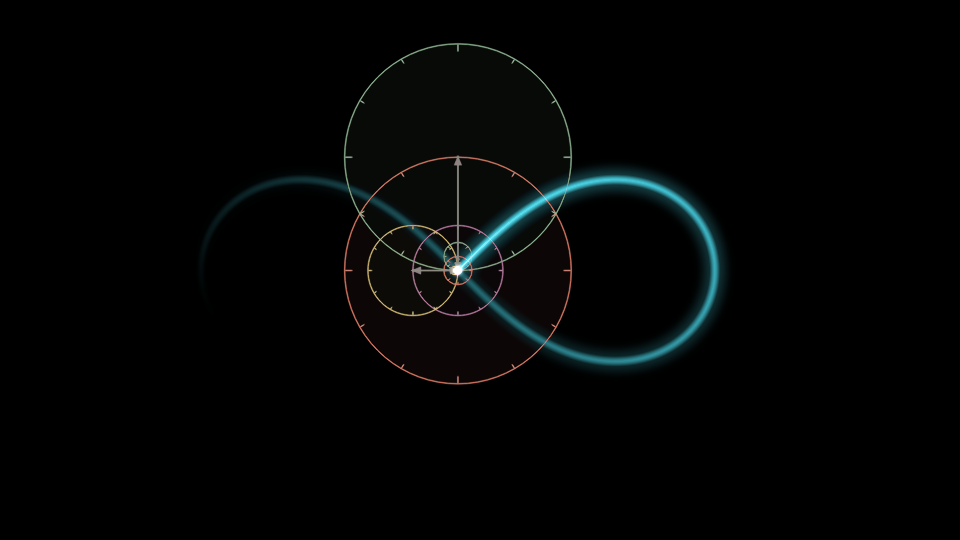
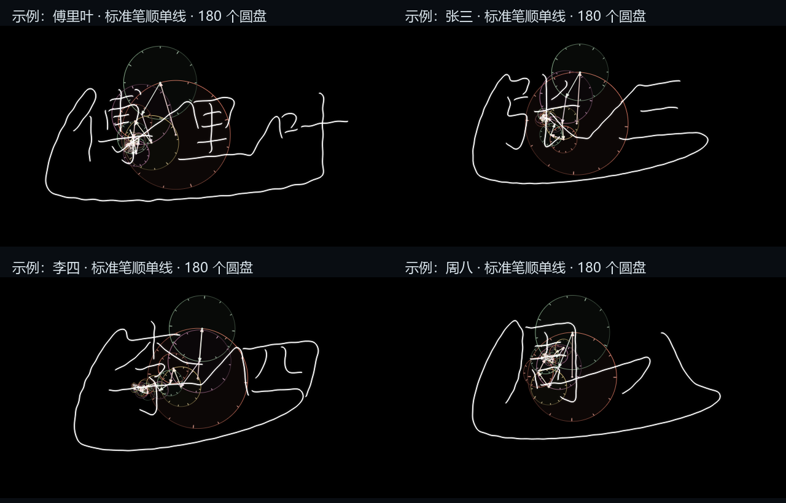
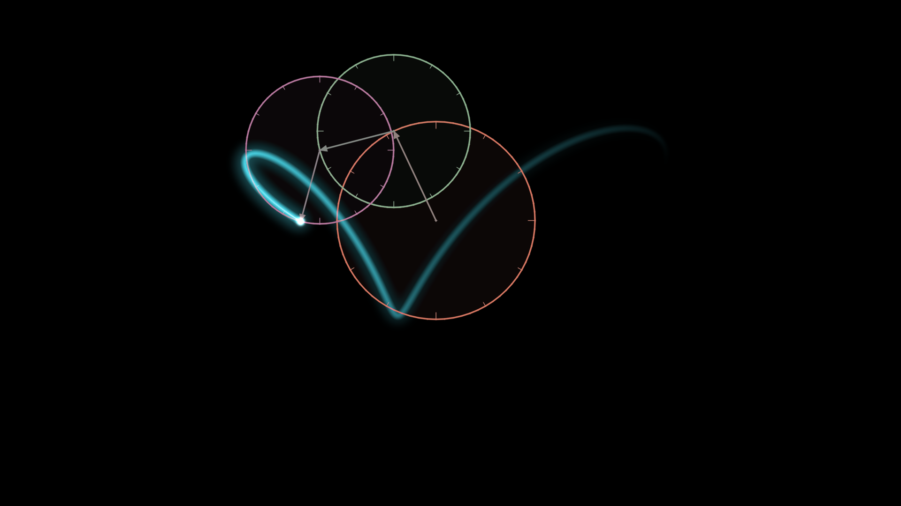

# Fourier Studio · 交互式傅里叶动态壁纸

本地图片或随机频谱 → 原有 FFT 圆盘 → 平滑参数漂移 → 渐隐发光尾迹 → 实时预览与 MP4 导出。

Turn any image, Chinese-character stroke order, or random spectrum into an animated
Fourier epicycle drawing — with parameter drift, glowing fading trails, live preview and MP4 export.

## 效果预览

| 圆盘重建 | 标准笔顺汉字 | 渐变尾迹 |
|---|---|---|
|  |  |  |

导出成品见仓库根目录的 `Fourier_Bernoulli_60s.mp4`、`Fourier_Meteor_Preview.mp4` 等文件。

## 安装与启动

需要 Python 3.10+。Windows 官方 Python 包含 Tkinter，本项目未新增 pip 依赖。

```powershell
python -m pip install -r requirements.txt -i https://pypi.tuna.tsinghua.edu.cn/simple
python main.py
```

如果使用本项目的虚拟环境：

```powershell
.venv\Scripts\python.exe main.py
```

也可双击 `install.bat` 安装依赖，之后双击 `run.bat` 启动。安装脚本仅本次使用清华镜像，不修改全局 pip 配置。

参数窗口等待点击 **开始预览 / 应用参数** 后才开始计算。预览帧在后台生成，计算期间界面仍可响应；准备超过 30 秒会恢复按钮并提示重试。GUI 诊断信息保存在项目目录的 `gui.log`。

运行无参数 `python main.py` 会打开启动页。点击 **开始运行** 后弹出参数与预览窗口：

1. **上传本地图片**：选择 SVG、PNG 或 JPG。文件只在本机读取。
2. **输入文字**：输入中文名字/汉字（默认“傅里叶”）。默认字形来源为“标准笔顺单线”：直接读取标准笔顺中线，以统一比例和基线排列字符，不把字体图片映射成笔画。它是标准单线字形，不是行书字体。行书字体自动映射保留为实验选项；外轮廓模式用于保留真实字体边界。只有后两种模式启用本地字体选项。实际字迹完全由所选圆盘的傅里叶向量之和绘出，所有圆盘半径固定、角速度固定，画笔线宽固定。默认字内换笔时不留墨，勾选“显示全部连接线”可恢复连续留墨；圆盘和末端光点在换笔期间仍连续运动。盘数越少，字形越简化；增加盘数才逐渐接近目标。字间目标连线为直线，首尾目标回线从字外绕行；关闭首尾相连会改为直线返回起点且不留墨。
3. **随机运动**：选择随机种子、最高频率和高频衰减；点击“换一组随机运动”生成另一组。

调节左侧参数后点击 **开始预览 / 应用参数**。参数栏可滚动，右侧支持暂停、继续和预览速度调整。**导出当前预览 MP4** 使用最后一次成功应用的参数；导出在后台运行，期间自动暂停实时预览，完成后恢复此前的播放状态。进度栏显示已完成帧数、实际处理帧率、已用时间和预计剩余时间；最终封装完成才显示 100%。导出取消或失败时清理临时文件，保留原有正式视频。编码管道写入和 MP4 收尾超过 120 秒没有进展时自动报错；取消导出也能中止阻塞中的 FFmpeg。

预览使用 800×450 的基础画面并保持比例适配窗口，预览速度滑块仅影响实时播放；导出使用完整循环时长、选定的分辨率和 FPS。默认文字 GUI 为 180 个圆盘、60 秒长循环；命令行默认仍为 200 个圆盘。

## 五个新增参数

| 参数 | 含义 | 默认值 |
|---|---|---|
| `drift_strength` | 半径、相位和瞬时频率的平滑漂移强度 | 0.18，范围 0～0.75 |
| `drift_period` | 目标漂移周期，单位秒，会对齐完整循环 | 30 秒 |
| `trail_length` | 轨迹保留时间，单位秒 | 8 秒，不超过循环时长 |
| `fade_power` | 年龄渐隐指数，越大尾迹衰减越快 | 2，范围 0.2～8 |
| `glow_strength` | 尾迹发光强度 | 0.8，范围 0～3 |

命令行同时接受连字符和下划线，例如 `--drift-strength` 与 `--drift_strength` 等价。

其他调节项：圆盘数、采样数、完整循环时长、基础旋转周期、尾迹颜色（cyan / blue / purple）、圆环线宽/亮度/刻度、视频分辨率及 FPS。随机模式额外提供种子、最高频率和高频衰减。

## 无窗口直接导出

```powershell
# 默认示例 SVG；1080p、60 FPS、60 秒、200 圆盘
python main.py --headless --overwrite

# 自己的 SVG 或黑白图片
python main.py --headless --input "my shape.svg" --duration 120 --drift-period 30 --trail-length 10 --preview preview_drift.png --output Fourier_Drift.mp4

# 名字汉字文字模式（默认华文行楷）
python main.py --headless --source text --text "傅里叶" --circles 100 --duration 15 --trail-mode loop --output Fourier_Name.mp4

# 草书字体，字体文件已随项目保存，可离线选择
python main.py --headless --source text --font assets/fonts/LongCang-Regular.ttf --output Fourier_Cursive.mp4

# 随机运动，固定种子可复现
python main.py --headless --source random --seed 42 --circles 60 --max-frequency 64 --spectral-decay 1.3 --duration 60 --trail-length 8 --output Fourier_Random.mp4

# 快速查看一段短循环
python main.py --headless --source random --circles 30 --width 960 --height 540 --fps 30 --duration 12 --rotation-period 4 --drift-period 12 --trail-length 3 --output quick_drift.mp4 --preview preview_drift.png

# 保留此前的纯白闭合曲线与暖色指针/刻度圆盘
python main.py --headless --trail-mode loop --duration 10 --output Fourier_White.mp4

# 从零逐步绘制，周期边界清空轨迹，因此不承诺无缝
python main.py --headless --trail-mode draw --duration 10 --output Fourier_Drawing.mp4
```

新默认模式为 `drift`：彩色最新轨迹最亮、最饱和，旧轨迹逐渐变暗并消失；标准笔顺和实验字体映射尾迹的几何线宽保持固定。查看完整名字可选 `loop` 模式，从头观察书写顺序可选 `draw` 模式。输出默认路径仍是当前工作目录下的 `Fourier_Wallpaper.mp4`。

## 字体和笔顺数据

推荐模式 `ordered` 直接使用 [Hanzi Writer Data](https://github.com/chanind/hanzi-writer-data) 的标准笔顺中线，每个字的每一笔对应原始数据中的一条路径。全串字符只做统一缩放、平移和字间排版，没有按字体骨架吸附、额外补画或按姓名校准。数据缺失时明确报错，不自动改用实验字体映射。首次使用未缓存汉字需要联网下载，后续读取 `assets/strokes` 缓存。该模式不读取本地字体，不能将结果称为华文行楷或草书。

例如 `python main.py --headless --text "张三" --text-style ordered --trail-mode draw --circles 180`。较少圆盘会产生真实重建误差，标准目标数据也不保证低盘数下文字可辨认。

华文行楷、方正舒体、楷体读取本机字体，不打包系统字体。志莽行书、龙藏体、刘建毛草来自 [Google Fonts](https://github.com/google/fonts/tree/main/ofl)，字体与各自的 SIL OFL 许可证保存在 `assets/fonts`。

实验模式 `signature`：字体文件只有字形，不包含书写动作。程序会尝试加载 `assets/signatures/` 下的校准 JSON（按字体 SHA-256 匹配）来复用人工标注的单笔轨迹；未提供校准文件时自动回退到字体骨架引导。`assets/strokes/font_anchors.json` 可存放字体主笔画的引导点，默认留空。校准数据是针对特定字体与特定文字的特例，不随仓库分发，也不能推广成任意名字都正确。目标轨迹等弧长采样后进行 FFT，只保留用户所选数量的系数。圆盘末端与实际字迹使用同一个截断傅里叶和，没有独立字体轮廓覆盖层。

实验映射用标准笔顺引导实际字体中线，但交叉、连笔、草书合并会使对应关系不唯一，仍可能缺笔或字形错误。因此不作为默认方案；需要准确行书动作时应提供该字体对应的真实单线轨迹和笔顺数据。

所有笔画和过渡共享线性时间变量，不逐笔暂停、加减速；换笔只切换是否留墨，末端光点一直跟随机构。签名满足 `z(t)=Σ c_k exp(2π i k t/T)`，每个圆盘角速度为 `2πk/T`，方向与整数频率对应。各盘匀速不代表末端线速度严格恒定：末端速度由向量叠加决定；等弧长目标采样使高盘数重建趋近均匀书写，低盘数仍会有速度变化。强制末端恒速需要改变时间变量，也会让各圆盘改变角速度，因此这里优先保证傅里叶结构。圆环沿周向渐变，刻度跟随对应向量转动，小圆渐隐；高速刻度按渲染帧率降低对比度以减轻频闪。

## 平滑运动和长周期循环

`FourierModel`、轮廓提取和 FFT 系数生成保持原有逻辑。新增的 `DriftingModel` 只给固定参数增加动态外壳：

- 半径和相位使用确定的低频正弦调制，起止时回到原始半径和相位。
- 瞬时频率也使用正弦调制，但角度是瞬时频率的**解析积分**；不直接用 `frequency(t) * t`。
- 随机模式只在初始化时根据种子产生频谱，后续运动完全确定，不逐帧生成噪声。
- 基础旋转在完整视频内完成整数圈，漂移函数也采用整数谐波，起止位置和速度连续。

设完整视频循环为 T，目标漂移周期为 P：

`m = max(1, round(T/P))`

实际漂移周期为 `T/m`、`T/(m+1)`、`T/(m+2)`，分配给各圆盘的半径、相位、频率调制。它们共同构成长循环；控制台与预览状态栏显示实际周期。例如 T=60、P=30 时，周期为 30、20、15 秒，整体在 60 秒后重复。

基础旋转周期同样对齐整数圈：`B=max(1,round(T/rotation_period))`，实际周期为 `T/B`。想要更长时间才重复，可将完整循环设为 120 或 180 秒；任意指定周期无法同时严格保持有限时长无缝，所以这里会明确对齐。

## 渐隐尾迹如何衔接

轨迹通过周期缓存保存末端历史。当前时间之前的点使用它们的真实年龄：

`age_ratio = age_seconds / trail_length`

`alpha = (1-age_ratio)**fade_power`

透明度降至零，线宽也随年龄平滑减小。线芯使用连续的浮点线宽和距离抗锯齿，避免整数线宽切换造成两段亮区；接头和自交处取最亮的一次贡献，避免覆盖或叠加产生亮斑。只有当前真实末端保留最亮的白色光点，其后短线芯逐渐从亮白过渡到饱和的青/蓝/紫，再持续变暗。发光参数增强近场和远场光晕，最大值 3 产生更明显的流星效果。为避免首次播放没有历史、循环时却有历史，第一帧预填充上一周期的末端轨迹；视频开始、结束时尾迹年龄分布相同。

画面满足 `frame(0) == frame(1)`，包含圆盘、指针和渐隐轨迹。编码采样使用 `[0,1)`，不重复写入 `t=1`，最后一帧接到第一帧仍是正常帧间隔。H.264 为有损编码，数学状态一致不等于解码像素逐位相同。

## 图片与配色

- SVG 直接解析曲线、圆弧、基本形状、viewBox 和组变换，再做数值近似等弧长采样。
- 默认跳过开放路径；命令行 `--close-open` 用直线补闭合，补线也会进入动画。
- SVG 文字请先转成路径；滤镜、裁剪、遮罩等复杂渲染效果不按最终外观提取。
- SVG 会忽略位于目标下方、覆盖画布的实心无描边背景矩形，避免把白色背景当成轮廓；只有一个矩形的 SVG 仍可导入。
- 默认选择周长最长的一个闭合轮廓；命令行 `--contour-index 1` 选择第二长轮廓。
- 多个不连通轮廓、孔洞不强行拼接，可分别生成或自行设计连续连接路径。
- 位图自动灰度化、Otsu 二值化并提取轮廓；命令行 `--edges` 可启用 Canny。`--threshold` 和 `--polarity` 可控制阈值与主体颜色。
- 透明 PNG 合成在白背景上；建议使用对比清晰、主体不接触边框的图形。
- 随机模式圆盘数最多为可用非零频率数（2×最高频率，且受采样数约束），界面状态会显示实际圆盘数。

背景黑色，圆盘沿用珊瑚红、鼠尾草绿、柔紫、暖金色，保留半径箭头和短刻度。小圆减少装饰，防止密集细节拥挤。原始 `loop` 模式的目标曲线为纯白色。

## 伯努利双纽线（Lemniscate of Bernoulli）

直接在图片模式选择 `assets/bernoulli_lemniscate.svg`。文件由数学参数方程离散生成，整个“∞”是一个连续闭合、自相交的路径，没有背景矩形；在中心交叉处不会拆成两瓣。

要保持伯努利双纽线形状，请将**漂移强度设为 0**。`drift` 模式仍可显示流星渐隐轨迹；`loop` 模式显示完整的纯白闭合双纽线。开启漂移会让这个初始图形逐渐变形。

```powershell
python main.py --input assets/bernoulli_lemniscate.svg --gui
```

参数方程参考：[Wolfram MathWorld · Lemniscate](https://mathworld.wolfram.com/Lemniscate.html)。SVG 中采用 4096 个点进行高精度折线近似，导入后仍按等弧长重新采样并生成 Fourier 圆盘。

## 导出与性能

默认导出 H.264 / yuv420p MP4，适合导入 Wallpaper Engine 视频壁纸。关闭漂移、帧数与周期对齐时，程序只渲染一个基础旋转周期，再无损重复生成完整时长；不会在内存中缓存几千张高清原始帧。开启漂移时仍按完整长周期逐帧生成。宽高必须是偶数，实际帧数为 `round(duration*fps)`。

OpenCV / NumPy 在 CPU 上绘制，尾迹使用 float32 连续距离场，仅计算轨迹附近区域，并用 16-bit 亮度查表避免逐帧重复幂运算；远场光晕使用半分辨率处理，帧通过管道送入 FFmpeg；不需要保存所有视频帧。预览帧率随机器性能变化，60 FPS 指导出视频的播放帧率，不保证实时渲染。

`imageio-ffmpeg` 在常用平台 wheel 中自带 FFmpeg。可选硬件编码：

```powershell
python main.py --headless --encoder h264_nvenc --ffmpeg "C:\ffmpeg\bin\ffmpeg.exe"
```

还支持 h264_qsv / h264_amf，需要相应显卡、驱动和支持该编码器的 FFmpeg 构建。硬件编码只加速编码，圆盘与尾迹仍由 CPU 绘制。

## 验证

```powershell
python -m unittest discover -s tests -v
```

测试覆盖原有 FFT 与轮廓输入，新增频率积分、周期位置/速度、镜头范围、随机可复现、尾迹年龄和边界、视频取消清理，以及真实 Tk 控件上的图片选择、预览、暂停、随机再生成、后台导出。

主要文件：`main.py`（共享渲染/CLI 入口）、`dynamics.py`（漂移和渐隐）、`gui.py`（窗口）、`run.bat`（启动）。

接口参考：[NumPy FFT 官方文档](https://numpy.org/doc/stable/reference/generated/numpy.fft.fft.html)、[svgelements 官方仓库](https://github.com/meerk40t/svgelements)。
